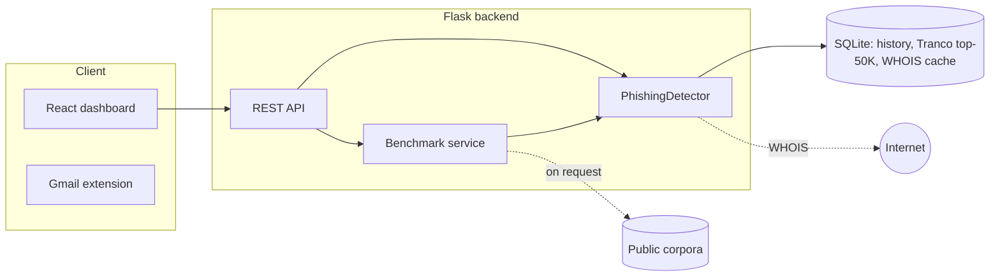

<div align="center">

# PhishGuard

**Explainable phishing-email detection: a rule-based engine, a Flask API, a React dashboard with a built-in benchmark suite, and a Gmail extension.**

[](https://github.com/pranavmirkar/phishing-detector/actions/workflows/ci.yml)


[](LICENSE)


</div>

PhishGuard scores an email from its sender, reply-to, subject and body, and **shows its reasoning**: every verdict is a
list of findings (lookalike domain, deceptive link, brand impersonation, ...) with the evidence behind each one, plus the
Levenshtein edit-distance working for domain comparisons. There is no black box and no external AI service: the
detector is deterministic, runs offline, and is measured against both synthetic and real public email corpora.

> **Status:** a university project that has grown into a small, tested tool. Read [Accuracy](#accuracy) and
> [Limitations](#limitations) before relying on any number in this README.

## Contents

- [Features](#features) · [Screenshots](#screenshots) · [How it works](#how-it-works)
- [Quick start](#quick-start) · [API](#api) · [Benchmarks tab](#benchmarks-tab)
- [Accuracy](#accuracy) · [Limitations](#limitations)
- [Project structure](#project-structure) · [Development](#development) · [Roadmap](#roadmap) · [Acknowledgements](#acknowledgements) · [License](#license)

## Features

| Layer | What it catches |
|---|---|
| **Sender domain** | Lookalikes by edit distance (typos, swapped letters, digit substitutions), look-alike characters (Cyrillic, `rn`→`m`), punycode/IDN, brand names used in domains the brand does not own (`paypal-secure.com`, `paypal.xyz`), brands hidden in subdomains, throw-away TLDs, account/security words in the name |
| **Sender identity** | Free-mail providers are **never** treated as trusted; display names or mailbox names claiming a brand (`"PayPal Support" <x@gmail.com>`, `"Amazon.com" <x@some-isp.net>`) |
| **Content** | Account-takeover wording (a threat + a requested action + a deadline), fake IT/webmail-administrator lures, payment-redirection and advance-fee wording, a brand named in the text that does not match the sender |
| **Links** | Visible URL vs real destination (compared by *registrable domain*, so `click.nytimes.com` and `nytimes.com` match), URL shorteners, raw IPs, punycode, unrelated destinations in automated brand mail |
| **Headers** | `Reply-To` pointing somewhere unrelated; optional SPF / DKIM / DMARC results from an `Authentication-Results` header |
| **Domain age** | WHOIS registration age, cached for 24 h |
| **Spam signals** | Keyword density, ALL-CAPS and exclamation-mark subjects, bulk-mail patterns, URL density (discounted for verified senders) |

Also included: a light/dark dashboard, scan history, an educational page on attack patterns, an interactive
Levenshtein matrix, a one-click **Benchmarks** tab, 46 automated tests, and CI on every push.

## Screenshots

<table>
<tr>
<td width="50%"><br><sub><b>Analyze</b> — a flagged email, its evidence and the edit-distance matrix</sub></td>
<td width="50%"><br><sub><b>Benchmarks</b> — real public corpora, confusion matrix, cut-off sweep</sub></td>
</tr>
<tr>
<td colspan="2"><br><sub><b>Dashboard</b> — light theme (dark theme above)</sub></td>
</tr>
</table>

## How it works



1. **Parse** the sender into display name, mailbox and registrable domain (aware of suffixes such as `co.uk`).
2. **Establish identity.** A domain is *trusted* only if it is in the Tranco top-50K list and is not a free-mail provider.
   Trust is never inherited by look-alike characters: only the original, un-normalised domain can earn it.
3. **Compare** untrusted domains with the top-1K domains plus a curated list of 80 frequently phished brands
   (banks, couriers, payment services) using Levenshtein distance. Adjacent swaps count as one edit, and a 2-edit
   match needs a high similarity so that `t-online.de` vs `f1online.de` is not a verdict.
4. **Score** each signal with a fixed weight; the total is capped at 100 and mapped to **LOW** (< 25),
   **MEDIUM** (25-54) or **HIGH** (>= 55). Spam signals add a small, separately weighted amount.
5. **Explain.** The API returns every finding with a severity, message and detail, and the matrix/edit operations
   for the closest trusted domain.

Brand, free-mail and TLD data live in [`backend/brands.py`](backend/brands.py) so they can be reviewed and extended
without touching scoring logic; the scoring itself is in [`backend/detector.py`](backend/detector.py).

## Quick start

**Requirements:** Python 3.10+, Node 18+.

```bash
git clone https://github.com/pranavmirkar/phishing-detector.git
cd phishing-detector

# 1. Backend  ->  http://localhost:5000
cd backend
pip install -r requirements.txt
python app.py          # first start downloads the Tranco list (~50K domains) in the background

# 2. Frontend ->  http://localhost:3000   (in a second terminal)
cd frontend
npm install
npm run dev
```

Run the backend from inside `backend/` (it opens `phishing.db` relative to the working directory).

### Gmail extension

`extension/` is a Manifest V3 Chrome extension that analyses senders inside Gmail. Open `chrome://extensions`,
enable *Developer mode*, choose **Load unpacked** and select the `extension/` folder. It runs entirely in the browser
with its own bundled copy of the trusted-domain list; it does not call the backend (see [Limitations](#limitations)).

## API

Base URL `http://localhost:5000/api`.

| Method | Endpoint | Purpose |
|---|---|---|
| `POST` | `/analyze` | Score one email and store it in history |
| `GET` | `/emails`, `/emails/<id>` | Scan history / one scan with full analysis |
| `POST` | `/report` | Mark a scan as reported phishing |
| `GET` | `/stats` | Totals, 7-day trend, detections by type, intel status |
| `POST` | `/matrix` | Levenshtein matrix and edit operations for two strings |
| `GET` / `POST` | `/intel/status`, `/intel/update`, `/intel/whois` | Trusted-domain list status / refresh, WHOIS lookup |
| `GET`, `POST`, `DELETE` | `/benchmarks/...` | [Benchmark service](#benchmarks-tab) |

```bash
curl -s -X POST http://localhost:5000/api/analyze \
  -H "Content-Type: application/json" \
  -d '{
        "sender": "support@paypa1.com",
        "reply_to": "reply@protonmail.com",
        "subject": "Urgent: your PayPal account has been suspended",
        "content": "Verify your account: <a href=\"http://paypa1.com/v\">https://paypal.com/verify</a>",
        "auth_results": "spf=fail dkim=none dmarc=fail"
      }'
```

`reply_to` and `auth_results` (a header string or an object such as `{"spf": "pass"}`) are optional. The response
contains `risk_score` (`LOW`/`MEDIUM`/`HIGH`), `risk_level` (0-100), the `warnings` list, and `domain_analysis`
(normalised form, nearest trusted domains, matrix, edit operations).

## Benchmarks tab

The dashboard's **Benchmarks** tab runs the detector on labelled emails and reports accuracy, precision, recall, F1,
ROC AUC, a confusion matrix, a cut-off sweep, per-category results and every misclassified email.

| Source | Details |
|---|---|
| **Private datasets** | Two bundled synthetic sets (306 and 258 emails) in `backend/benchmark/` |
| **Real public datasets** | [Nazario's phishing corpus](https://monkey.org/~jose/phishing/) and the [SpamAssassin public corpus](https://spamassassin.apache.org/old/publiccorpus/). Downloaded on request (one click, ~12 MB, fixed URLs) into the git-ignored `backend/benchmark/data/`; never redistributed. Choose the test half, dev half or all, and the number of emails per class |
| **Your own file** | Upload `.jsonl`, `.json` or `.csv` with `label` (`phishing`/`legit`), `sender`, `subject`, `content` and optionally `reply_to`, `category`. Up to 2,000 rows, processed in memory and not stored |

Runs are background jobs (one at a time) using the same `PhishingDetector.analyze()` as `/api/analyze`, with WHOIS
switched off so results are repeatable. Only sender domains, never message text, are kept from the public corpora.

The same benchmarks are available from the command line:

```bash
cd backend
python benchmark/run_benchmark.py                                          # bundled development set
python benchmark/run_benchmark.py --dataset dataset_v2.jsonl --tag holdout # second set
python -P benchmark/eval_real.py --phishing P.mbox --ham H.tar.bz2 --split test   # real corpora
```

## Accuracy

Positive class = phishing; an email is flagged when its score is MEDIUM or above (25+). "Before" is the first version
of this project; "After" is the current detector.

### Real public mail — the number to trust

Phishing from Nazario's corpus (2015) and legitimate mail from the SpamAssassin "easy ham" corpus. Neither was written
by this project. Each corpus was split 50/50 by a hash of sender and subject; issues were diagnosed on the **dev** half
and the figures below are from the **test** half (151 phishing, 400 legitimate).

| Metric | Before | After |
|---|---|---|
| Phishing caught (recall) | 43.0% | **75.5%** |
| Legitimate mail wrongly flagged | 45.0% | **1.0%** |
| Precision | 26.5% | **96.6%** |
| F1 | 32.8% | **84.8%** |
| Balanced accuracy | 49.0% | **87.2%** |

Before the rewrite the detector was close to a coin flip on real mail. Most of the gain is fewer false alarms:
free-mail was treated as trusted, any domain containing a digit or "cl" counted as a homoglyph attack, and newsletter
tracking links counted as deceptive.

### Synthetic sets

Written by the project author, so high scores are expected and say less. They are useful as regression baselines.

| Set | Before (accuracy) | After (accuracy / F1) | Notes |
|---|---|---|---|
| Development, 306 emails | 85.0% | 100% / 100% | Used to guide the fixes. **Not a real-world claim** |
| Second set, 258 emails | 51.9% | 97.3% / 97.8% | Different seed, wording and brands, but the same author |

Full tables, per-category results and misclassified messages:
[`REPORT.md`](backend/benchmark/REPORT.md), [`REPORT_holdout.md`](backend/benchmark/REPORT_holdout.md) and the real-data
aggregates in [`backend/benchmark/results_real_test.json`](backend/benchmark/results_real_test.json).

### Method notes

- The test half was not used to *design* rules, but one later fix (generic host words such as `mail.` wrongly counted
  as brands in subdomains) was prompted by an error seen on the test half. The test numbers are therefore very slightly
  less independent than the rest.
- Both real corpora contain near-duplicate campaigns (for example many lures for the same bank), which flatters
  results somewhat.
- An early dataset bug (a few generated "lookalikes" such as `google.org` are genuinely brand-owned) was found by the
  benchmark and fixed in the dataset builders rather than hidden.

## Limitations

- **Forged mail from a brand's real address** (`billing@paypal.com`) with a clean body is invisible without
  authentication headers. The API accepts `auth_results`, but the dashboard and extension do not send it yet. This
  accounts for most of the phishing still missed on real data.
- At the stricter **HIGH-only** cut-off, real-data recall is about 40%. HIGH has near-zero false alarms; MEDIUM is the
  recommended "review this" level.
- The real corpora are 2002-2015 era and mostly English. The detector only sees sender, subject and body: no
  attachments, rendering, or sender reputation beyond domain age.
- Legitimate newsletters sent via a different tracking domain are still occasionally flagged.
- It is rule-based. The numbers describe these datasets, not future attacks, and attackers can adapt to known rules.
- The **Gmail extension** has its own simpler JavaScript implementation and has not been updated to the new rules, so
  none of the figures above apply to it.
- Do not use this as the only line of defence. Treat it as a second opinion.

## Project structure

```
backend/
  app.py                  Flask API (analyze, history, stats, intel)
  detector.py             Scoring engine
  brands.py               Brand / free-mail / TLD threat data
  domain_intel.py         Tranco list + WHOIS cache
  levenshtein.py          Distance, DP matrix, edit operations
  benchmark_service.py    /api/benchmarks blueprint (background jobs, downloads)
  benchmark/              Datasets, builders, CLI runners, metrics, corpus readers, reports
  tests/                  46 offline tests
frontend/src/
  pages/                  Dashboard, Analyze, History, Benchmarks, Attack patterns
  components/ api/ theme.js
extension/                Manifest V3 Gmail extension
docs/screenshots/         README images
.github/workflows/ci.yml  Tests + frontend build
```

## Development

```bash
cd backend && pip install pytest && python -m pytest -q     # 46 tests, offline, < 2 s
cd frontend && npm run build                                # production build
```

Tests replace the trusted-domain list, lookalike pool and WHOIS with small fakes, so they need no network or database.
CI runs the backend tests and a frontend build on every push and pull request.

To extend detection, add brands to `backend/brands.py`, add a signal in `detector.py` with a test in
`backend/tests/test_detector.py`, then run the benchmarks and compare with the tables above.

## Roadmap

- Send `Authentication-Results` from the dashboard and extension; parse raw `.eml` upload
- Port the new rules to the Gmail extension (or have it call the API)
- Larger, more recent real-world evaluation set, including attachments and HTML-only mail
- Per-signal weight calibration with a held-out set, and a confidence estimate on each verdict

## Acknowledgements

- [Tranco](https://tranco-list.eu/): Le Pochat et al., *Tranco: A Research-Oriented Top Sites Ranking Hardened Against Manipulation*, NDSS 2019
- Jose Nazario's [phishing corpus](https://monkey.org/~jose/phishing/) and the [Apache SpamAssassin public corpus](https://spamassassin.apache.org/old/publiccorpus/), used for evaluation only
- [python-whois](https://pypi.org/project/python-whois/), [Flask](https://flask.palletsprojects.com/), [React](https://react.dev/), [Vite](https://vitejs.dev/), [Chart.js](https://www.chartjs.org/)

## License

Released under the [MIT License](LICENSE). The public email corpora used for evaluation are not part of this
repository and remain under their own terms.

## Disclaimer

PhishGuard is an educational project and a decision aid, not a security product. It can miss real attacks and flag
legitimate mail. No warranty is provided.
