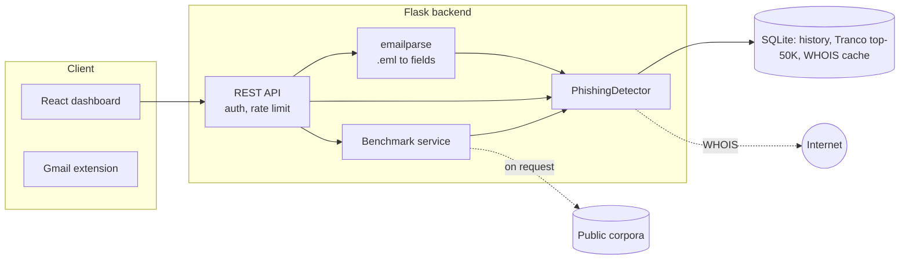

<div align="center">

# PhishGuard

**Explainable phishing-email detection: a rule-based engine, a hardened Flask API, a React dashboard with a built-in benchmark suite, and a Gmail extension.**

[](https://github.com/pranavmirkar/phishing-detector/actions/workflows/ci.yml)


[](LICENSE)


</div>

PhishGuard scores an email and **shows its reasoning**: every verdict is a list of findings (lookalike domain, forged
sender, failed authentication, deceptive link, risky attachment, ...) with the evidence behind each one. It reads
ordinary pasted fields or a **raw `.eml` message with headers**, runs offline and deterministically, keeps your mail on
your machine, and is benchmarked on real public phishing from 2015 to 2025, not only on data it was written against.

> **Honest status.** On a locked, time-held-out test of 2023-2025 phishing, PhishGuard catches **72%** of phishing
> and wrongly flags **2.7%** of the legitimate mail in that test. That is a useful *"take a second look"* assistant,
> far better than where this project started, and **not** a replacement for a commercial email-security gateway.
> The [accuracy section](#accuracy) has the full picture, including what is still bad.

## Contents

[Features](#features) · [Screenshots](#screenshots) · [How it works](#how-it-works) · [Quick start](#quick-start) ·
[Using it with real mail](#using-it-with-real-mail) · [Configuration](#configuration) · [Deployment](#deployment) ·
[API](#api) · [Benchmarks tab](#benchmarks-tab) · [Accuracy](#accuracy) · [Limitations](#limitations) ·
[Development](#development) · [Roadmap](#roadmap) · [Acknowledgements](#acknowledgements) · [License](#license)

## Features

| Layer | What it catches |
|---|---|
| **Sender domain** | Lookalikes by edit distance (typos, swaps, digits), look-alike characters (Cyrillic, `rn`→`m`), punycode, brand names in domains the brand does not own (`paypal-secure.com`), brands hidden in subdomains, throw-away TLDs, credential words in the name |
| **Sender identity** | Free-mail is never "trusted"; display names claiming a brand (`"PayPal Support" <x@gmail.com>`, `"DHL International" <x@some-ministry.gov>`); your own organisation's name used by an outsider |
| **Headers** (raw `.eml`) | SPF / DKIM / DMARC results from the receiving server's `Authentication-Results`, envelope sender (`Return-Path`) that contradicts a brand `From`, `Reply-To` hijack, own-domain forgery that fails authentication. Spam-filter verdicts (`X-Spam-*`) are deliberately ignored |
| **Content** | Account-takeover wording (threat + action + deadline), fake IT / webmail-admin lures, document-share and "pending mail" lures, payment-problem lures, payment-redirection (BEC) and advance-fee wording, text disguised with look-alike letters |
| **Links** | Visible URL vs real destination (by registrable domain), mail that claims a brand but never links to it, free-hosting platforms used for fake logins, shorteners, raw IPs |
| **Attachments** | HTML attachments, executables and scripts, double extensions, archives from unverified senders (names only; attachments are never opened) |
| **Forms** | Password / card fields inside the message body |
| **Domain age** | WHOIS registration age, cached for 24 h |

Plus: light/dark dashboard, scan history, an interactive Levenshtein matrix, a one-click **Benchmarks** tab, API-key
auth, rate limiting, optional "do not store message bodies" mode, Docker packaging, and an automated test suite.

## Screenshots

<table>
<tr>
<td width="50%"><br><sub><b>Analyze</b> — an imported raw .eml: authentication failure, envelope mismatch, risky attachment, plus the edit-distance working</sub></td>
<td width="50%"><br><sub><b>Benchmarks</b> — real-world view with confidence intervals on the locked 2023-2025 test</sub></td>
</tr>
<tr>
<td colspan="2"><br><sub><b>Dashboard</b> — light theme</sub></td>
</tr>
</table>

## How it works



1. **Parse.** A raw message becomes sender, reply-to, subject, body (HTML kept for links and forms), the
   *topmost* `Authentication-Results` (the receiving server's; lower ones can be forged), envelope sender, attachment
   names and recipient.
2. **Establish identity.** A domain is *trusted* only if it is in the Tranco top-50K and is not a free-mail provider.
   Trust is never inherited by look-alike characters.
3. **Compare** with the top-1K domains plus 80 curated, frequently phished brands (banks, couriers, payments).
4. **Score** each signal with a fixed weight, capped at 100: **LOW** (< 25), **MEDIUM** (25-54), **HIGH** (>= 55).
   Spam-looking mail alone can never reach MEDIUM: a message needs at least one phishing-specific indicator.
5. **Explain.** Every finding carries a severity, message and detail.

Brand, free-mail and TLD data live in [`backend/brands.py`](backend/brands.py); scoring is in
[`backend/detector.py`](backend/detector.py); raw-message parsing is in [`backend/emailparse.py`](backend/emailparse.py).

## Quick start

**Requirements:** Python 3.10+ and Node 18+ (or just Docker, see [Deployment](#deployment)).

```bash
git clone https://github.com/pranavmirkar/phishing-detector.git
cd phishing-detector

# 1. Backend  ->  http://localhost:5000   (works from any directory)
pip install -r backend/requirements.txt
python backend/app.py            # first start downloads the Tranco list (~50K domains) in the background

# 2. Frontend ->  http://localhost:3000   (second terminal)
cd frontend && npm install && npm run dev
```

## Using it with real mail

1. In Gmail open a message, **⋮ → Show original → Download original** (or save any `.eml` from your mail client).
2. Open the **Analyze** tab and click **Import .eml**. Sender, reply-to, subject and body fill in, and the header
   evidence (authentication, envelope sender, attachments, recipient) is shown and sent with the analysis.
3. Click **Analyze**. Try [`docs/samples/forged-paypal.eml`](docs/samples/forged-paypal.eml), a forged PayPal message with
   failed SPF/DMARC, a mismatched envelope sender and an HTML attachment.

Set `PG_OWN_DOMAINS` to your organisation's domain(s) to catch outsiders who name your organisation in a display name
or forge your own domain, a favourite trick of mail-merged lures (see the ablation under [Accuracy](#accuracy)).

For automation, `POST /api/parse` turns raw text into fields and `POST /api/analyze` scores them.

## Configuration

All optional environment variables:

| Variable | Default | Purpose |
|---|---|---|
| `PG_DB` | `backend/phishing.db` | SQLite file (history, trusted-domain list, WHOIS cache) |
| `PG_API_KEY` | *(none)* | If set, every `/api/*` call except `/api/health` needs `X-API-Key: <value>` |
| `PG_RATE_LIMIT` | `120` | Analyses per minute per client (`0` = off) |
| `PG_STORE_CONTENT` | `1` | `0` = never keep message bodies in history |
| `PG_OWN_DOMAINS` | *(none)* | Your organisation's domains, e.g. `example.com,example.org` |
| `PG_CORS_ORIGINS` | local dev servers | Comma-separated allowed web origins |
| `PG_TRUST_PROXY` | `0` | `1` behind nginx / a load balancer, so rate limits use the real client IP |
| `PG_HOST` / `PG_PORT` | `127.0.0.1` / `5000` | Bind address for `python app.py`. Debug mode is off unless `PG_DEBUG=1` |

## Deployment

```bash
docker compose up --build        # web UI + API at http://localhost:8080
```

The compose file runs the backend under gunicorn as a non-root user with a persistent volume for the database and
downloaded benchmark data, and serves the built frontend through nginx, which proxies `/api`. Pass the variables above
through the environment, for example `PG_OWN_DOMAINS=example.com docker compose up --build`.

CI builds both images, starts the stack and smoke-tests it on every push (see `.github/workflows/ci.yml`). The images
have not been built on the author's machine (Docker was not running there), so treat the CI run as the verification.

**Privacy.** Everything runs on your machine or server. Message bodies are stored in the history table only when
`PG_STORE_CONTENT=1`; WHOIS lookups send only the sender's domain name to WHOIS servers; benchmark corpora are
downloaded on request from their original sites and never uploaded anywhere.

## API

Base URL `http://localhost:5000/api`.

| Method | Endpoint | Purpose |
|---|---|---|
| `POST` | `/analyze` | Score one email and store it in history |
| `POST` | `/parse` | Parse a raw RFC 822 message (`{"raw": "..."}`) into analyzable fields |
| `GET` | `/emails`, `/emails/<id>` | History / one scan with full analysis |
| `POST` | `/report` | Mark a scan as reported phishing |
| `GET` | `/stats` | Totals, 7-day trend, detections by type, intel status |
| `POST` | `/matrix` | Levenshtein matrix and edit operations for two strings |
| `GET` / `POST` | `/intel/status`, `/intel/update`, `/intel/whois` | Trusted-domain list status / refresh, WHOIS lookup |
| `GET` | `/health` | Liveness probe (never needs the API key) |
| `GET`, `POST`, `DELETE` | `/benchmarks/...` | [Benchmark service](#benchmarks-tab) |

```bash
curl -s -X POST http://localhost:5000/api/analyze -H "Content-Type: application/json" -d '{
  "sender": "service@paypal.com",
  "reply_to": "help@account-help-center.top",
  "subject": "Your PayPal account has been limited",
  "content": "<a href=\"http://account-help-center.top/signin\">https://www.paypal.com/signin</a>",
  "auth_results": "spf=fail dmarc=fail",
  "return_path": "bounce@mailer-dispatch.xyz",
  "attachments": [{"filename": "Statement.html"}]
}'
```

Only `sender` is required. Optional header-derived fields: `reply_to`, `auth_results` (string or object), `return_path`,
`recipient`, `attachments`, `list_id`. The response has `risk_score` (`LOW`/`MEDIUM`/`HIGH`), `risk_level` (0-100), the
`warnings` list and `domain_analysis`.

## Benchmarks tab

The **Benchmarks** tab runs the detector on labelled emails and shows accuracy, precision, recall, F1, ROC AUC,
**false alarms per 1,000 legitimate emails with 95% intervals**, precision at realistic phishing rates, recall at fixed
false-alarm budgets, a confusion matrix, a cut-off sweep, per-source results, a readiness table, latency and every
misclassified email.

| Source | Details |
|---|---|
| **Private datasets** | Two bundled synthetic sets (306 and 258 emails) |
| **Real public datasets** | Download on request (one click per group, fixed URLs, never redistributed) into git-ignored storage. *Core* (~10 MB) and *Recent* (~85 MB). Choose the **Test** split (2023-2025 phishing), **Dev** split (2015-2022) or both |
| **Your own file** | `.jsonl` / `.json` / `.csv` with `label` (`phishing`/`legit`), `sender`, `subject`, `content` and optionally `reply_to`, `auth_results`, `return_path`, `recipient`, `category`. Up to 2,000 rows, processed in memory |

The same engine runs from the command line:

```bash
cd backend
python benchmark/run_benchmark.py                          # bundled synthetic sets
python -P benchmark/eval_real.py --split both              # real corpora: dev, then test at a dev-calibrated cut-off
python -P benchmark/eval_real.py --split test --drop recipient,auth_results   # ablation: blank out signals
```

## Accuracy

Positive class = phishing; an email is flagged at risk score >= 25 (MEDIUM+). **Always read these next to the
[limitations](#limitations).**

### The test that matters: recent real phishing, time-held-out

| Split | Phishing | Legitimate |
|---|---|---|
| **Dev** (rules were diagnosed here) | Nazario 2015, 2018, 2019, 2022 | SpamAssassin ham and hard ham (dev half), Apache mailing lists 2025 (5 list-months) |
| **Test** (locked; never inspected during tuning) | **Nazario 2023, 2024, 2025** | SpamAssassin ham and hard ham (test half), Apache mailing lists 2025 (5 other list-months) |

600 phishing and 600 legitimate emails per split (seeded sample). The three detector versions below are the original
project, the previous commit, and now:

| Test split (2023-25 phishing) | Original | Previous | **Now** |
|---|---|---|---|
| Phishing caught (recall) | 34.2% | 50.7% | **72.3%** (95% CI 68.6-75.8) |
| **False alarms per 1,000 legitimate emails** | 350 | 55 | **26.7** (16.5-42.9) |
| Precision (balanced test set) | 49.4% | 90.2% | **96.4%** |
| Precision if 1 email in 100 is phishing | 1.0% | 8.5% | **21.5%** |
| HIGH-only: recall / false alarms per 1,000 | 4.2% / 40 | 21.2% / 15 | **44.7% / 8.3** |
| Development split: recall / false alarms per 1,000 | 41.2% / 345 | 63.8% / 35 | **83.2% / 15.0** |

Recall on the test split by year: **2023 80.1%**, **2024 78.3%**, **2025 61.1%**. The newest phishing is caught least,
so expect further decay as attackers adapt.

**Which signals carry the result** (test split; false alarms stay between 26.7 and 28.3 per 1,000 in every row):

| Inputs available to the detector | Recall |
|---|---|
| Everything (full `.eml` and the recipient's domain) | 72.3% |
| Without knowing the recipient's organisation | 61.0% |
| Body, sender and subject only (no headers at all) | 55.8% |

So most of the recent gain depends on real message headers and knowing whose mailbox it is, which is exactly what the
`.eml` import and `PG_OWN_DOMAINS` provide. A tool that only sees pasted text is closer to 56%.

**Strict cut-offs do not transfer perfectly.** A cut-off picked on dev for <= 0.5% false alarms (score 52) gave
**46.5% recall and 13.3 false alarms per 1,000** on test: the false-alarm budget was missed by about 2.6x.

### Is it real-world acceptable?

The Benchmarks tab scores the detector against three project-defined tiers (these are this project's own targets, not
an industry standard):

| Tier | Target | Result on the test split |
|---|---|---|
| Warning assistant | >= 70% caught, <= 20 false alarms per 1,000 | Recall met (72.3%); **false alarms not met (26.7, interval 16.5-42.9)** |
| Inbox filter | >= 90% caught, <= 1 false alarm per 1,000 | **Not met** |
| Production gateway | >= 99% caught, <= 0.1 false alarms per 1,000 | **Not met** (roughly where commercial products operate) |

**Bottom line:** use it as a second opinion that a person reviews: MEDIUM = "look twice", HIGH = "probably phishing"
(98% precision on the balanced test set, but only 44.7% recall). Do not use it to hide or delete mail automatically.

### Synthetic sets

Written by the project author, so high scores are expected and say little. They are regression baselines.

| Set | Original (accuracy) | Now (accuracy / F1) |
|---|---|---|
| Development, 306 emails | 85.0% | 100% / 100% (used to guide fixes; not a real-world claim) |
| Second set, 258 emails | 51.9% | 97.3% / 97.8% |

Reports: [`REPORT.md`](backend/benchmark/REPORT.md), [`REPORT_holdout.md`](backend/benchmark/REPORT_holdout.md),
[`results_real_test.json`](backend/benchmark/results_real_test.json), [`results_real_dev.json`](backend/benchmark/results_real_dev.json).

### Metric definitions

- **False alarms per 1,000** = legitimate emails flagged per 1,000, with a 95% Wilson interval.
- **Precision at 1% prevalence** = precision if only 1 in 100 emails were phishing. Balanced test sets overstate
  precision: in a real inbox most flags would be false at this accuracy.
- **Recall at a false-alarm budget** picks the cut-off on the data itself, so on one set it is optimistic; the dev to
  test row above is the honest version.

## Limitations

- **Legitimate mail in the public corpora is narrow:** 2002-03 personal and list mail and 2025 developer mailing lists.
  Marketing mail, receipts, corporate mail and newsletters are **not represented**, so the false-alarm rate on a real
  inbox is unmeasured and probably higher. The hardest legitimate bucket we have (SpamAssassin "hard ham", mail that
  looks like spam) is flagged 12.7% of the time.
- **Authentication false alarms are unmeasured:** the legitimate corpora carry no SPF results, so wrongly flagged
  forwarded or mailing-list mail cannot be counted. Attackers also usually pass their *own* SPF, so authentication
  catches forged brands, not all phishing.
- **Single-victim phishing corpus.** Nazario's phishing all targets one mailbox, which makes organisation-impersonation
  look better than it will for diverse recipients (see the ablation). Near-duplicate campaigns flatter results slightly.
- **Forged mail from a brand's real address with a clean body** and no authentication data is invisible. Mail with
  no text (images, QR codes) cannot be read.
- Recall falls on newer phishing (80% for 2023, 61% for 2025) and rules need continued maintenance.
- WHOIS domain-age scoring is off in all benchmarks, so it is unmeasured.
- The **Gmail extension** has its own older, simpler JavaScript implementation. None of the figures here apply to it.
- Rule-based: figures describe these datasets, not future attacks.

## Development

```bash
cd backend && pip install pytest && python -m pytest -q      # offline, < 3 s
cd frontend && npm run build
```

Tests replace the trusted-domain list, lookalike pool and WHOIS with small fakes and use a throw-away database, so they
need no network. To extend detection: add brands to `backend/brands.py`, add a signal in `detector.py` with a test, then
run `eval_real.py --split dev` and compare. Do **not** tune on the test split; if you do, say so next to the numbers.

```
backend/
  app.py                  API: auth, rate limit, analyze, parse, history, stats
  detector.py             Scoring engine          emailparse.py   Raw .eml parser
  brands.py               Brand / free-mail / TLD data
  domain_intel.py         Tranco list + WHOIS cache (cached lookups)
  benchmark_service.py    /api/benchmarks (jobs, downloads)
  benchmark/              engine, metrics, corpora catalogue, CLI runners, datasets, reports
  tests/                  detector, parser, API and benchmark tests
frontend/src/             pages (Dashboard, Analyze, History, Benchmarks, Patterns), components, theme
extension/                Manifest V3 Gmail extension (separate implementation)
docs/                     screenshots, sample .eml
docker-compose.yml        backend (gunicorn) + web (nginx)
```

## Roadmap

- Gmail extension that calls the API (so it gets the new rules and header data)
- Per-signal weight calibration with a learned model on a larger, more diverse labelled set, and a calibrated probability
- A modern consumer-mail legitimate set (newsletters, receipts), and image/QR-code lure detection
- A feedback loop: user-confirmed phishing / false alarms stored and fed back into evaluation

## Acknowledgements

- Phishing data: Jose Nazario, [phishing corpus](https://monkey.org/~jose/phishing/), licensed
  [CC BY 4.0](https://creativecommons.org/licenses/by/4.0/). Used for evaluation only; not redistributed here.
- Legitimate mail: [Apache SpamAssassin public corpus](https://spamassassin.apache.org/old/publiccorpus/) and
  [Apache Software Foundation public mailing-list archives](https://lists.apache.org/). Downloaded on request for
  evaluation only; only sender domains and aggregate statistics are kept.
- [Tranco](https://tranco-list.eu/): Le Pochat et al., *Tranco: A Research-Oriented Top Sites Ranking Hardened Against
  Manipulation*, NDSS 2019.
- [python-whois](https://pypi.org/project/python-whois/), [Flask](https://flask.palletsprojects.com/), [React](https://react.dev/),
  [Vite](https://vitejs.dev/), [Chart.js](https://www.chartjs.org/), [gunicorn](https://gunicorn.org/), [nginx](https://nginx.org/).

## License

Released under the [MIT License](LICENSE). The public email corpora used for evaluation are not part of this repository
and remain under their own terms.

## Disclaimer

PhishGuard is an educational project and a decision aid, not a security product. It can miss real attacks and flag
legitimate mail. No warranty is provided.
