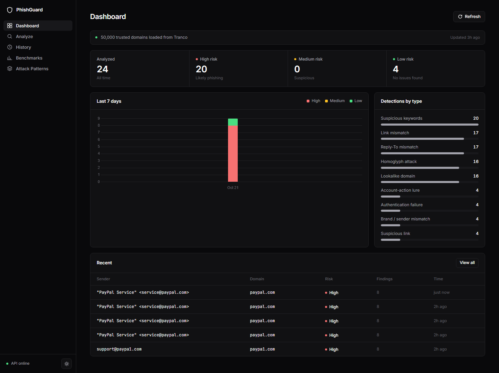
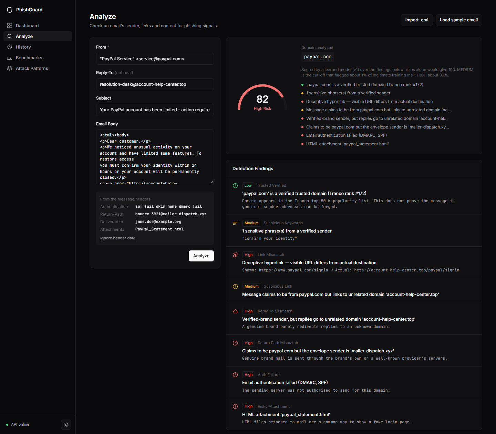
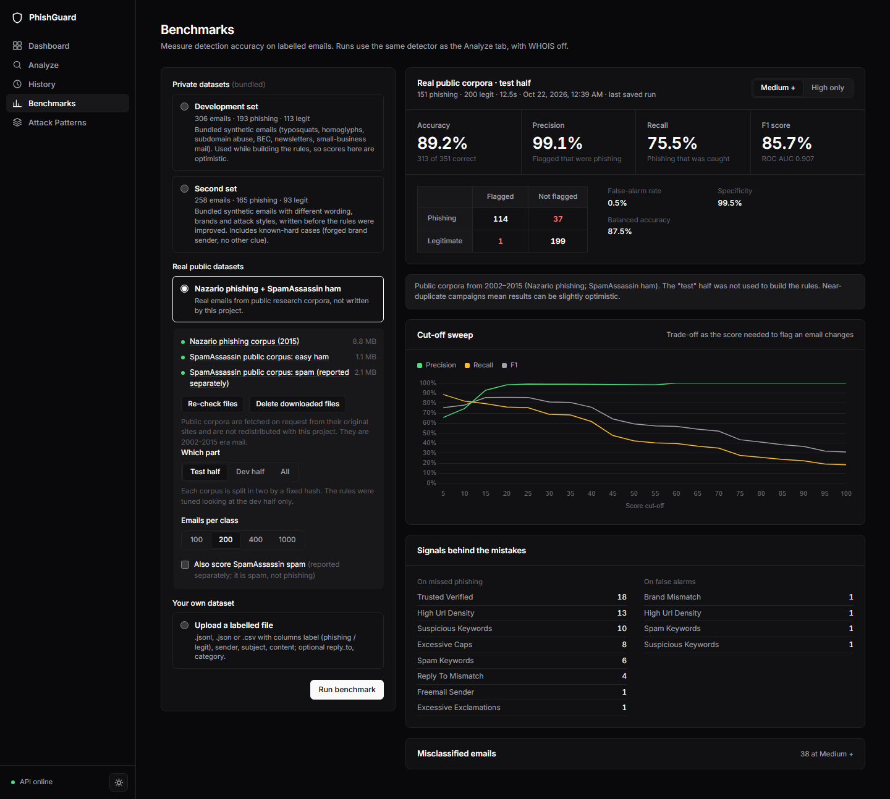
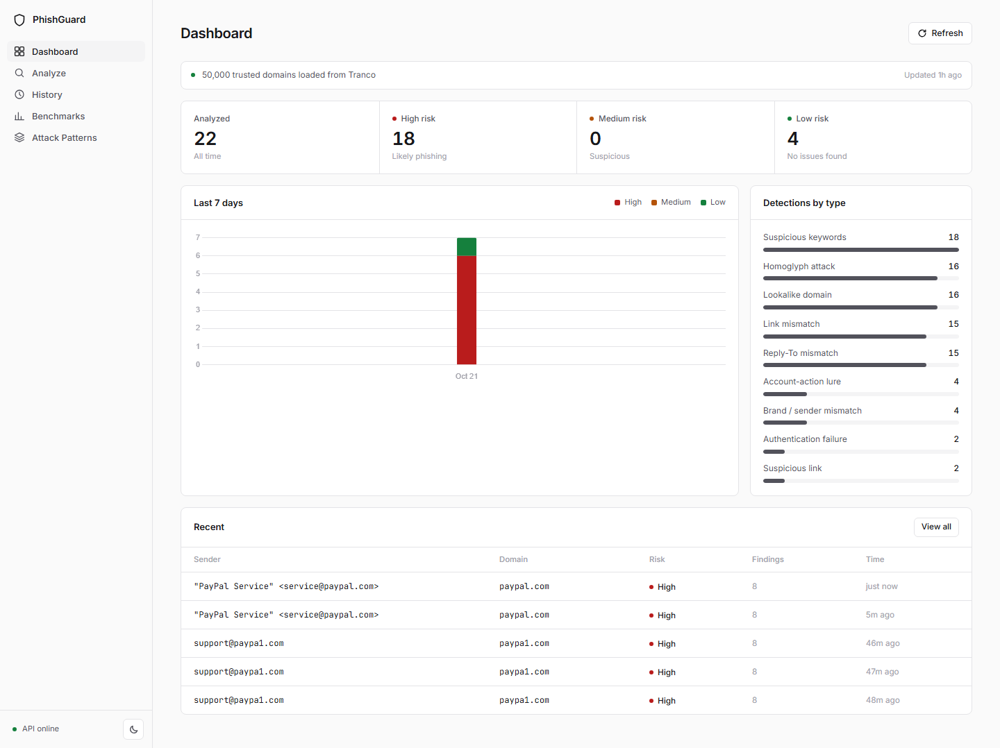
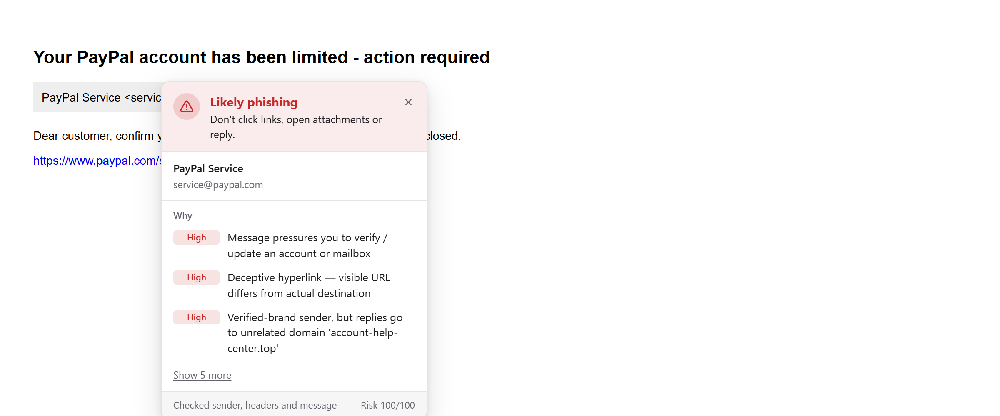
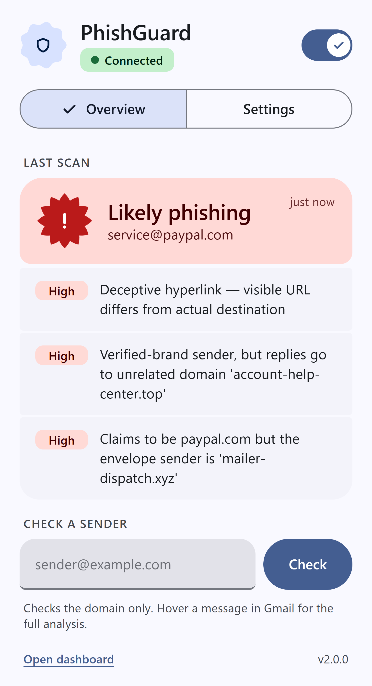
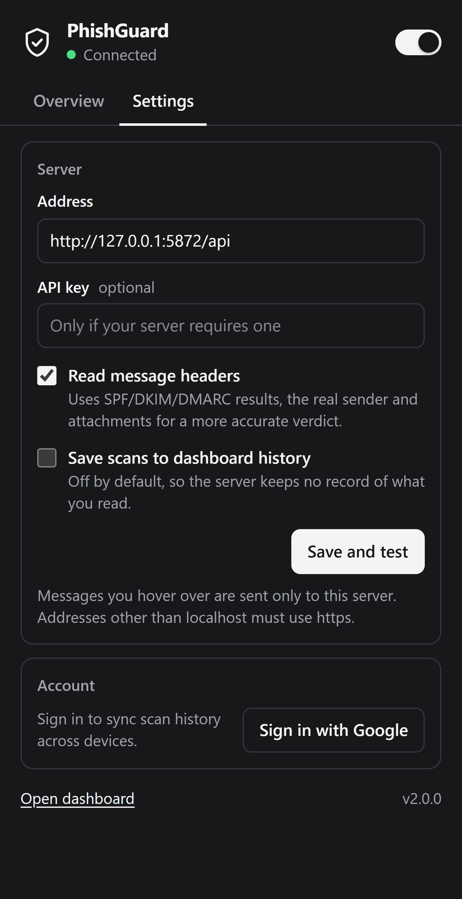
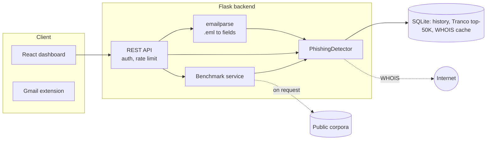

<div align="center">

# PhishGuard

**Explainable phishing-email detection: a rule-based engine, a hardened Flask API, a React dashboard with a built-in benchmark suite, and a Gmail extension.**

[](https://github.com/pranavmirkar/phishing-detector/actions/workflows/ci.yml)


[](LICENSE)



</div>

PhishGuard scores an email and **shows its reasoning**: every verdict is a list of findings (lookalike domain, forged
sender, failed authentication, deceptive link, risky attachment, ...) with the evidence behind each one. It reads
ordinary pasted fields or a **raw `.eml` message with headers**, runs offline and deterministically, keeps your mail on
your machine, and is benchmarked on real public phishing from 2015 to 2025, not only on data it was written against.

> **Honest status.** On a locked test of **unseen 2024-2025 phishing** and ~4,500 unseen legitimate emails, PhishGuard
> catches **92.3%** of phishing and wrongly flags **1.4%** of the legitimate mail in that test (13.9 per 1,000). That
> makes it a solid *"take a second look"* assistant, but it is **not** a replacement for a commercial email-security
> gateway, and the legitimate test mail is narrow (no marketing mail or receipts). The [accuracy section](#accuracy)
> shows exactly what was measured, what was not, and where it is still weak.

## Contents

[Features](#features) · [Screenshots](#screenshots) · [How it works](#how-it-works) · [Quick start](#quick-start) ·
[Using it with real mail](#using-it-with-real-mail) · [Configuration](#configuration) · [Deployment](#deployment) ·
[API](#api) · [Benchmarks tab](#benchmarks-tab) · [Accuracy](#accuracy) · [Limitations](#limitations) ·
[Development](#development) · [Roadmap](#roadmap) · [Acknowledgements](#acknowledgements) · [License](#license)

## Features

| Layer | What it catches |
|---|---|
| **Sender domain** | Lookalikes by edit distance (typos, swaps, digits), look-alike characters (Cyrillic, `rn`→`m`), punycode, brand names in domains the brand does not own (`paypal-secure.com`), brands hidden in subdomains, throw-away TLDs, credential words in the name |
| **Sender identity** | Free-mail is never "trusted"; display names claiming a brand (`"PayPal Support" <x@gmail.com>`, `"DHL International" <x@some-ministry.gov>`); your own organisation's name used by an outsider |
| **Headers** (raw `.eml`) | SPF / DKIM / DMARC results from the receiving server's `Authentication-Results`, envelope sender (`Return-Path`) that contradicts a brand `From`, `Reply-To` hijack, own-domain forgery that fails authentication. Spam-filter verdicts (`X-Spam-*`) are deliberately ignored |
| **Content** | Account-takeover wording (threat + action + deadline), fake IT / webmail-admin lures, document-share and "pending mail" lures, payment-problem lures, payment-redirection (BEC) and advance-fee wording, text disguised with look-alike letters |
| **Links** | Visible URL vs real destination (by registrable domain), mail that claims a brand but never links to it, free-hosting platforms used for fake logins, shorteners, raw IPs |
| **Attachments** | HTML attachments, executables and scripts, double extensions, archives from unverified senders (names only; attachments are never opened) |
| **Forms** | Password / card fields inside the message body |
| **Link destinations** | Share of links to obscure (non-top-50K) domains, plain-http links, long / deep URLs, the recipient's address inside a URL |
| **Domain age** | WHOIS registration age (bounded wait, cached, failures remembered) |
| **Learned scoring** | A small tree model combines all of the above into the final score ([model card](backend/MODEL_CARD.md)); rules still explain every verdict |

Plus: light/dark dashboard, scan history, an interactive Levenshtein matrix, a one-click **Benchmarks** tab, API-key
auth, rate limiting, optional "do not store message bodies" mode, Docker packaging, and an automated test suite.

## Screenshots

<table>
<tr>
<td width="50%"><br><sub><b>Analyze</b> — an imported raw .eml: authentication failure, envelope mismatch, risky attachment, plus the edit-distance working</sub></td>
<td width="50%"><br><sub><b>Benchmarks</b> — real-world view with confidence intervals on the locked 2023-2025 test</sub></td>
</tr>
<tr>
<td colspan="2"><br><sub><b>Dashboard</b> — light theme</sub></td>
</tr>
</table>

## Gmail extension

`extension/` is a Manifest V3 Chrome extension designed to Material 3 Expressive (tonal colour roles, large shapes, a verdict shape that turns spiky as the risk rises; light/dark follows the system). Hover a sender in Gmail and it sends the sender, subject and body (and,
for an opened message, Gmail's own "original message" so SPF/DKIM/DMARC, the envelope sender and attachments are
available) to **your** PhishGuard server and shows the same verdict and findings as the dashboard. If the server is
down it says so and runs a simplified local check instead.

<table>
<tr>
<td><br><sub><b>Panel</b>: the verdict first, then why</sub></td>
<td width="240"><br><sub><b>Popup</b>: overview, light</sub></td>
<td width="240"><br><sub><b>Settings</b>: dark</sub></td>
</tr>
</table>

1. Start the backend (`python app.py`, default `http://localhost:5000`).
2. `chrome://extensions` → Developer mode → **Load unpacked** → select `extension/`.
3. Open the extension popup, check the server address (and API key if you set `PG_API_KEY`), and press **Save & test**.

Message content goes only to the server address you configure. Non-local servers must use https and need an explicit
browser permission for that one origin; scans are not saved to the dashboard history unless you tick the option.
Tests: `cd extension && node --test test/api.test.js test/background.integration.test.js` (the second starts the real
backend); `node test/e2e/gmail_mock.e2e.js` drives real Chrome against a mock Gmail page (needs Chrome and openssl).

## How it works



1. **Parse.** A raw message becomes sender, reply-to, subject, body (HTML kept for links and forms), the
   *topmost* `Authentication-Results` (the receiving server's; lower ones can be forged), envelope sender, attachment
   names and recipient.
2. **Establish identity.** A domain is *trusted* only if it is in the Tranco top-50K and is not a free-mail provider.
   Trust is never inherited by look-alike characters.
3. **Compare** with the top-1K domains plus 80 curated, frequently phished brands (banks, couriers, payments).
4. **Score.** Every signal gets rule points. A learned model (gradient-boosted trees, evaluated in pure Python) reads those
   points plus era-neutral lexical and link features and produces the 0-100 score: **LOW** (< 25), **MEDIUM** (25-54),
   **HIGH** (>= 55), where MEDIUM is the cut-off that flagged ~1% of legitimate training mail and HIGH ~0.1%. For
   signals the training data cannot judge (fewer than 20 phishing examples), and for look-alike / homoglyph domains
   of protected brands, the rule points are kept as a floor.
   `PG_MODEL=off` uses the rule score alone.
5. **Explain.** Every finding carries a severity, message and detail; the model changes the score, not the evidence.

Brand, free-mail and TLD data live in [`backend/brands.py`](backend/brands.py); scoring is in
[`backend/detector.py`](backend/detector.py); raw-message parsing is in [`backend/emailparse.py`](backend/emailparse.py).

## Quick start

**Requirements:** Python 3.10+ and Node 18+ (or just Docker, see [Deployment](#deployment)).

```bash
git clone https://github.com/pranavmirkar/phishing-detector.git
cd phishing-detector

# 1. Backend  ->  http://localhost:5000   (works from any directory)
pip install -r backend/requirements.txt
python backend/app.py            # first start downloads the Tranco list (~50K domains) in the background

# 2. Frontend ->  http://localhost:3000   (second terminal)
cd frontend && npm install && npm run dev
```

## Using it with real mail

1. In Gmail open a message, **⋮ → Show original → Download original** (or save any `.eml` from your mail client).
2. Open the **Analyze** tab and click **Import .eml**. Sender, reply-to, subject and body fill in, and the header
   evidence (authentication, envelope sender, attachments, recipient) is shown and sent with the analysis.
3. Click **Analyze**. Try [`docs/samples/forged-paypal.eml`](docs/samples/forged-paypal.eml), a forged PayPal message with
   failed SPF/DMARC, a mismatched envelope sender and an HTML attachment.

Set `PG_OWN_DOMAINS` to your organisation's domain(s) to catch outsiders who name your organisation in a display name
or forge your own domain, a favourite trick of mail-merged lures (see the ablation under [Accuracy](#accuracy)).

For automation, `POST /api/parse` turns raw text into fields and `POST /api/analyze` scores them.

## Configuration

All optional environment variables:

| Variable | Default | Purpose |
|---|---|---|
| `PG_DB` | `backend/phishing.db` | SQLite file (history, trusted-domain list, WHOIS cache) |
| `PG_API_KEY` | *(none)* | If set, every `/api/*` call except `/api/health` needs `X-API-Key: <value>` |
| `PG_RATE_LIMIT` | `120` | Analyses per minute per client (`0` = off) |
| `PG_STORE_CONTENT` | `1` | `0` = never keep message bodies in history |
| `PG_OWN_DOMAINS` | *(none)* | Your organisation's domains, e.g. `example.com,example.org` |
| `PG_MODEL` | bundled `model_v1.json` | `off` = rule score only, or a path to another model file |
| `PG_WHOIS` / `PG_WHOIS_TIMEOUT` | on / `3` | `PG_WHOIS=0` disables WHOIS; the wait per lookup is hard-bounded (seconds) |
| `PG_CORS_ORIGINS` | local dev servers | Comma-separated allowed web origins |
| `PG_TRUST_PROXY` | `0` | `1` behind nginx / a load balancer, so rate limits use the real client IP |
| `PG_HOST` / `PG_PORT` | `127.0.0.1` / `5000` | Bind address for `python app.py`. Debug mode is off unless `PG_DEBUG=1` |

## Deployment

```bash
docker compose up --build        # web UI + API at http://localhost:8080
```

The compose file runs the backend under gunicorn as a non-root user with a persistent volume for the database and
downloaded benchmark data, and serves the built frontend through nginx, which proxies `/api`. Pass the variables above
through the environment, for example `PG_OWN_DOMAINS=example.com docker compose up --build`.

### Render (API only, for the browser extension)

`render.yaml` is a Render Blueprint for the API: **New → Blueprint →** choose this repo. Render builds `backend/Dockerfile`,
generates a `PG_API_KEY`, and serves `https://<name>.onrender.com`. Then in the extension popup set **Address** to
`https://<name>.onrender.com/api`, paste the key (Render → service → Environment), and press **Save and test**.

- The API is public, so the key is what protects it; keep `PG_API_KEY` set. Anyone with the key can send mail to your
  server for analysis, and the extension sends the messages you hover over to it.
- On Render's free plan the service sleeps when idle and the first request after that takes 30-60 s; the extension then
  shows its offline fallback for that message. A paid plan avoids this.
- The free plan's disk is not persistent: the trusted-domain list is downloaded again on each start (the first minute
  after a start uses a smaller list) and scan history is lost. Scans are not saved by default anyway.

CI builds both images, starts the stack and smoke-tests it on every push (see `.github/workflows/ci.yml`). The images
have not been built on the author's machine (Docker was not running there), so treat the CI run as the verification.

**Privacy.** Everything runs on your machine or server. Message bodies are stored in the history table only when
`PG_STORE_CONTENT=1`; WHOIS lookups send only the sender's domain name to WHOIS servers; benchmark corpora are
downloaded on request from their original sites and never uploaded anywhere.

## API

Base URL `http://localhost:5000/api`.

| Method | Endpoint | Purpose |
|---|---|---|
| `POST` | `/analyze` | Score one email and store it in history |
| `POST` | `/parse` | Parse a raw RFC 822 message (`{"raw": "..."}`) into analyzable fields |
| `GET` | `/emails`, `/emails/<id>` | History / one scan with full analysis |
| `POST` | `/report` | Mark a scan as reported phishing |
| `GET` | `/stats` | Totals, 7-day trend, detections by type, intel status |
| `POST` | `/matrix` | Levenshtein matrix and edit operations for two strings |
| `GET` / `POST` | `/intel/status`, `/intel/update`, `/intel/whois` | Trusted-domain list status / refresh, WHOIS lookup |
| `GET` | `/health` | Liveness probe (never needs the API key) |
| `GET`, `POST`, `DELETE` | `/benchmarks/...` | [Benchmark service](#benchmarks-tab) |

```bash
curl -s -X POST http://localhost:5000/api/analyze -H "Content-Type: application/json" -d '{
  "sender": "service@paypal.com",
  "reply_to": "help@account-help-center.top",
  "subject": "Your PayPal account has been limited",
  "content": "<a href=\"http://account-help-center.top/signin\">https://www.paypal.com/signin</a>",
  "auth_results": "spf=fail dmarc=fail",
  "return_path": "bounce@mailer-dispatch.xyz",
  "attachments": [{"filename": "Statement.html"}]
}'
```

Only `sender` is required. Optional header-derived fields: `reply_to`, `auth_results` (string or object), `return_path`,
`recipient`, `attachments`, `list_id`. The response has `risk_score` (`LOW`/`MEDIUM`/`HIGH`), `risk_level` (0-100), the
`warnings` list and `domain_analysis`.

## Benchmarks tab

The **Benchmarks** tab runs the detector on labelled emails and shows accuracy, precision, recall, F1, ROC AUC,
**false alarms per 1,000 legitimate emails with 95% intervals**, precision at realistic phishing rates, recall at fixed
false-alarm budgets, a confusion matrix, a cut-off sweep, per-source results, a readiness table, latency and every
misclassified email.

| Source | Details |
|---|---|
| **Private datasets** | Two bundled synthetic sets (306 and 258 emails) |
| **Real public datasets** | Download on request (one click per group, fixed URLs, never redistributed) into git-ignored storage. *Core* (~10 MB) and *Recent* (~85 MB). Choose the **locked Test** split (unseen 2024-2025), **Dev**, **Val**, the **Seen** split or all. Groups: Core, Recent, Extended (validation years), Business (Enron sample, streamed) |
| **Your own file** | `.jsonl` / `.json` / `.csv` with `label` (`phishing`/`legit`), `sender`, `subject`, `content` and optionally `reply_to`, `auth_results`, `return_path`, `recipient`, `category`. Up to 2,000 rows, processed in memory |

The same engine runs from the command line:

```bash
cd backend
python benchmark/run_benchmark.py                          # bundled synthetic sets
python -P benchmark/eval_real.py --split test              # real corpora: the locked test (also: dev, val, test_seen, both)
python -P benchmark/eval_real.py --split test --drop recipient,auth_results   # ablation: blank out signals
PG_MODEL=off python -P benchmark/eval_real.py --split test                  # rule score only
```

## Accuracy

Positive class = phishing; an email is flagged at risk score >= 25 (MEDIUM+). **Read this next to the
[limitations](#limitations).**

### Protocol

| Split | Phishing (Nazario corpus, by **year**) | Legitimate (by **sender address**) |
|---|---|---|
| **Dev** (rules diagnosed here, model trained here) | 2015, 2018, 2019, 2022 | a quarter of SpamAssassin ham / hard ham, Enron corporate mail, Apache lists 2025 |
| **Val** (iteration checks, model trained here) | 2016, 2017, 2020, 2021, 2023 | another quarter, other lists |
| **Test: locked** | **2024, 2025, never scored or inspected** | the remaining half of every legitimate source |

Legitimate mail from one sender is never split across train and test, so near-duplicate threads cannot leak. The learned
model never saw anything later than 2023. Thresholds were calibrated on out-of-fold training predictions, not on the test.

### Result: locked test (418 unseen phishing, 4,542 unseen legitimate)

| | Original | Previous | Rules only (now) | **Now (rules + model)** |
|---|---|---|---|---|
| Phishing caught (recall) | 33.3% | 50.7% | 72.0% | **92.3%** (95% CI 89.4-94.5) |
| **Legitimate mail wrongly flagged, per 1,000** | 618 | 27.3 | 16.7 | **13.9** (10.9-17.7) |
| Precision if 1 email in 100 is phishing | 0.5% | 15.8% | 30.3% | **40.2%** |
| HIGH only: recall / false alarms per 1,000 | 3.3% / 461 | 15.1% / 2.0 | 46.4% / 3.1 | **84.4% / 2.2** |
| Median / p95 time per email | 88 / 170 ms | 51 / 121 ms | 28 / 42 ms | **28 / 45 ms** |

Recall by year: **2024 93.0%, 2025 91.7%**. False alarms by source: Enron corporate mail 1.7%, SpamAssassin ham 0.4-0.8%,
**SpamAssassin hard ham (legitimate mail that looks like spam) 4.0%**, Apache lists 0-5.3%.

**Which inputs matter** (same locked test): everything available 92.3% / 13.9 per 1,000; recipient's organisation
unknown 91.6% / 13.0; **body, sender and subject only (no headers at all) 86.8% / 12.5**. HIGH-only recall falls from
84.4% to 73.9% without headers.

**Calibration.** MEDIUM was set to flag 1% of legitimate training mail and flagged 1.4% on the test; HIGH was set to
0.1% and flagged 0.2%. Budgets transfer to within about 1.5-2x, not exactly.

### Is it real-world acceptable?

Scored against three project-defined tiers (this project's own targets, not an industry standard):

| Tier | Target | Locked test result |
|---|---|---|
| Warning assistant | >= 70% caught, <= 20 false alarms per 1,000 | **Met** (92.3%; 13.9, interval 10.9-17.7) |
| Inbox filter | >= 90% caught, <= 1 false alarm per 1,000 | **Not met** (13.9 per 1,000; HIGH 2.2 per 1,000 with 84.4% caught) |
| Production gateway | >= 99% caught, <= 0.1 false alarms per 1,000 | **Not met** (roughly where commercial products operate) |

**Bottom line:** use it as a second opinion that a person reviews: MEDIUM = "look twice", HIGH = "probably phishing"
(97% precision on the balanced test set, 84.4% recall). Do not use it to hide or delete mail automatically, and do not
read "Met" as a promise about your inbox: the legitimate test mail contains no marketing mail or receipts.

### Synthetic sets

Written by the project author, so high scores are expected and say little. They are regression baselines, and they are
how the learned model's blind spots were found (see below).

| Set | Original (accuracy) | Now (accuracy / F1) |
|---|---|---|
| Development, 306 emails | 85.0% | 98.4% / 98.7% |
| Second set, 258 emails | 51.9% | 95.7% / 96.6% |

Reports: [`REPORT.md`](backend/benchmark/REPORT.md), [`REPORT_holdout.md`](backend/benchmark/REPORT_holdout.md),
[`results_real_test.json`](backend/benchmark/results_real_test.json). Dev and Val numbers are not published as accuracy:
the model was trained on them.

### How the numbers came about (what was and was not independent)

- The first learned model scored **worse than the rules on the synthetic sets** (second set 97% to 80%): it had never
  seen delivery-fee scams, giveaways or text-only fraud. That is why signals with too little training support keep a
  rule floor. This choice was made from the synthetic and `test_seen` data **after** the pure model had scored 91.6% /
  11.2 per 1,000 on the locked test; the floor costs 2.7 false alarms per 1,000 at the same recall. Both numbers are
  recorded here.
- A CI smoke test later showed that `support@paypa1.com` with a one-line body scored LOW: the training data has few
  look-alike domains, so the model discounted them. Look-alike and homoglyph signals now always keep their rule points
  as a floor (`floor_always` in the model file). That change came from the smoke test, not from test-set errors; the
  locked test was re-run once afterwards: recall 91.6% to 92.3%, false alarms unchanged at 13.9 per 1,000. On the dev and
  `test_seen` splits it added about one legitimate false alarm per 500 emails and no recall change.
- Two emails crashed the detector on the first test run (malformed links). The bugs were fixed and the test re-run; no
  rule was tuned on test emails.
- When legitimate mail was re-split by sender, some legitimate emails that had been inspected earlier (while fixing
  false alarms) moved into the test split. Those fixes were generic (e.g. "a brand mention needs a link"), and the test
  has 4,542 legitimate emails, but the test is not perfectly untouched.
- Nazario's phishing is credential phishing aimed at one mailbox; near-duplicate campaigns can flatter results.

## Limitations

- **Legitimate mail in the public corpora is narrow:** 2002-03 personal and list mail, 1999-2002 corporate mail and 2025
  developer lists. Marketing mail, receipts, newsletters and consumer webmail are **not represented**. False alarms on a
  real inbox are unmeasured and probably higher, especially from the link-destination features.
- **It learns this data.** Attack styles the corpus barely contains (advance-fee scams, delivery-fee lures, BEC) rely on
  the rule floor, not learning. The data is mostly credential phishing.
- **Forged mail from a brand's real address with a clean body** and no authentication data is still hard. Mail whose
  content is an image or QR code cannot be read.
- **Drift.** Recall on the newest year was no lower than the previous one here, but phishing changes constantly; retrain
  regularly (see the [model card](backend/MODEL_CARD.md)). Link features lean on the current Tranco list.
- **Evasion.** Attackers who learn the features can adapt; the learned layer is not hardened.
- **Authentication false alarms are unmeasured** (the legitimate corpora carry no SPF results).
- WHOIS domain-age scoring is off in all benchmarks, so it is unmeasured.
- The **Gmail extension** is only as good as what Gmail's page exposes: the message-header fetch and the DOM selectors are tested against a mock page, not live Gmail, and Gmail changes its markup without notice. When the server is unreachable it falls back to an older, simpler local check that the benchmark figures do **not** describe (it reports 'no alert' for a forged paypal.com message, which is why the panel says so).
- Measured on emails in English (and a few other languages in the phishing set); a small multilingual lexicon covers
  non-English lures but false alarms on non-English legitimate mail are unmeasured.

## Development

```bash
cd backend && pip install -r requirements-dev.txt && python -m pytest -q      # offline, ~5 s
cd frontend && npm run build
```

Tests replace the trusted-domain list, lookalike pool and WHOIS with small fakes and use a throw-away database, so they
need no network. To extend detection: add brands to `backend/brands.py`, add a signal in `detector.py` with a test, then
run `eval_real.py --split val` and compare. If rules change, retrain the model (`python -P benchmark/train_model.py`).
Do **not** tune on the test split; if you do, say so next to the numbers.

```
backend/
  app.py                  API: auth, rate limit, analyze, parse, history, stats
  detector.py             Rule engine             emailparse.py   Raw .eml parser
  model.py + model_v1.json   Learned scoring layer (pure Python)   MODEL_CARD.md
  brands.py               Brand / free-mail / TLD data
  domain_intel.py         Tranco list + WHOIS cache (cached lookups)
  benchmark_service.py    /api/benchmarks (jobs, downloads)
  benchmark/              engine, metrics, corpora catalogue, train_model.py, CLI runners, datasets, reports
  tests/                  detector, parser, API and benchmark tests
frontend/src/             pages (Dashboard, Analyze, History, Benchmarks, Patterns), components, theme
extension/                Manifest V3 Gmail extension (calls the API; tests in extension/test)
docs/                     screenshots, sample .eml
docker-compose.yml        backend (gunicorn) + web (nginx)
```

## Roadmap

- Verify the extension against live Gmail across account types, and publish it to the Chrome Web Store
- Retrain on a larger, more diverse labelled set including marketing mail and receipts; calibrated probabilities
- A modern consumer-mail legitimate set (newsletters, receipts), and image/QR-code lure detection
- A feedback loop: user-confirmed phishing / false alarms stored and fed back into evaluation

## Acknowledgements

- Phishing data: Jose Nazario, [phishing corpus](https://monkey.org/~jose/phishing/), licensed
  [CC BY 4.0](https://creativecommons.org/licenses/by/4.0/). Used for evaluation only; not redistributed here.
- Legitimate mail: [Apache SpamAssassin public corpus](https://spamassassin.apache.org/old/publiccorpus/) and
  [Apache Software Foundation public mailing-list archives](https://lists.apache.org/). Downloaded on request for
  evaluation only; only sender domains and aggregate statistics are kept.
- [Tranco](https://tranco-list.eu/): Le Pochat et al., *Tranco: A Research-Oriented Top Sites Ranking Hardened Against
  Manipulation*, NDSS 2019.
- [python-whois](https://pypi.org/project/python-whois/), [Flask](https://flask.palletsprojects.com/), [React](https://react.dev/),
  [Vite](https://vitejs.dev/), [Chart.js](https://www.chartjs.org/), [gunicorn](https://gunicorn.org/), [nginx](https://nginx.org/).

## License

Released under the [MIT License](LICENSE). The public email corpora used for evaluation are not part of this repository
and remain under their own terms.

## Disclaimer

PhishGuard is an educational project and a decision aid, not a security product. It can miss real attacks and flag
legitimate mail. No warranty is provided.
